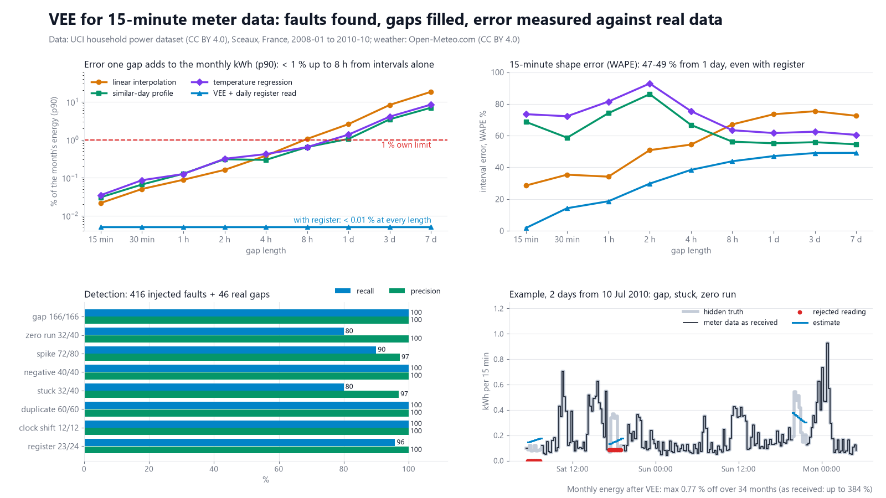

# interval-data-vee

Validation, estimation and editing (VEE) for 15-minute smart-meter data. I tested it on 34 months of a real household's data with 416 injected faults. Without register reads, an estimated gap of up to 8 h moves the monthly kWh by less than 1 % (p90). From 1 day on it does not.



## What it does

This is the step a meter-data system runs before billing: it checks the 15-minute values, fills what is missing or wrong, and records every change.

- **Reads** a meter file `timestamp,kwh`. Timestamps are interval starts, either with a UTC offset or as naive local time. In naive local time, the repeated autumn hour is read in file order (first pass = summer time). Times in the skipped spring hour are rejected and counted. Off-grid, unparseable and out-of-period rows are counted too. Every row is kept, so duplicates stay visible.
- **Validates** with eight rules:

  | rule | fires when |
  |---|---|
  | `GAP` | no reading for an interval |
  | `ZERO_RUN` | 4 or more exact zeros in a row (>= 1 h) |
  | `SPIKE` | above 3 kWh per 15 min (12 kW), or more than 0.9 kWh above both neighbours |
  | `NEGATIVE` | below 0 |
  | `STUCK` | 6 or more identical non-zero values in a row. The first value stays as an actual. |
  | `DUPLICATE` | 2 or more rows for one interval. Identical rows are dropped. For conflicting rows, the one closest to its neighbours is kept. |
  | `CLOCK_SHIFT` | a gap of 1 h or 2 h paired with a run of the same length of double readings up to 7 days away. This is the footprint of a meter clock that is off by that much, e.g. a missed DST switch. Candidate pairs are weighted by how much better the block fits the household's usual weekly profile once shifted back. The best set of pairs wins, and the block is moved back. |
  | `REGISTER_MISMATCH` | on a complete, otherwise clean day, the intervals differ from the daily register advance by more than 0.05 kWh + 2 %. The day is then prorated to the register. |

- **Estimates** every missing or rejected interval:
  - **linear interpolation** for gaps up to 4 h;
  - **similar-day profile** for longer gaps: the same local clock time on the same weekday, 1 to 4 weeks before and after, scaled to the 24 h of good data around the gap;
  - **temperature regression** for gaps of 1 day or more: daily kWh from heating degree days and weekend, fitted on complete days within ±6 weeks, then spread over the day with the profile shape.

  Optionally, the estimates of a day are then scaled so the day matches the daily register advance. The method limits (4 h, 1 day) were chosen on 2007 data only.
- **Keeps an audit trail.** Every edited interval gets one row: original value, new value, rule, method and edit timestamp (UTC).
- **Exports a plain CSV with quality flags.** Columns: `timestamp_utc, timestamp_local, kwh, status, flags, method`. Status is `A` actual, `C` corrected (clock shift, register prorate), `E` estimated or `M` missing. The audit is a second CSV: `timestamp_utc, rule, method, original_kwh, new_kwh, edited_at, note`. Example files: `examples/` (October 2009, which includes a missed autumn DST switch).

## Results

All numbers come from `python -m interval_vee demo` (seeds 7 and 11).

**The test.** The hidden truth is one real household (open data, see below). It covers 2008-01-01 to 2010-10-31 local time: 99,360 quarter-hours, 97,847 of them with a known value. The other 1,513 are 46 real gaps in the source. The rule thresholds and method limits were set on 2007 only. On the held-out period I injected 416 known faults into a meter file and ran it through the reader and VEE. The faults:
- 120 gaps (15 min to 3 days);
- 40 zero runs and 40 stuck runs (lengths 2 to 96 intervals);
- 80 spikes (45 gross, 35 subtle at +0.5 to 2.5 kWh);
- 40 negative values;
- 60 duplicates (36 conflicting);
- 12 clock shifts of ±1 h or ±2 h for 1 to 4 days, 2 of them missed autumn DST switches;
- 24 days where the interval values were scaled by 0.70 to 1.30 against the true register.

**Detection** (event level: an event counts as found if any of its intervals carries the rule's flag):

| rule | found / injected | recall | precision | what was missed |
|---|---:|---:|---:|---|
| gap (injected + real) | 166 / 166 | 100 % | 100 % | |
| zero run | 32 / 40 | 80 % | 100 % | all 8 runs of 2 intervals (below the 4-interval rule) |
| spike | 72 / 80 | 90 % | 97 % | 8 of 35 subtle spikes; 2 real peaks flagged |
| negative | 40 / 40 | 100 % | 100 % | |
| stuck | 32 / 40 | 80 % | 97 % | all 8 runs of 4 (below the 6-value rule); 1 real 26-interval flat run flagged |
| duplicate | 60 / 60 | 100 % | 100 % | |
| clock shift | 12 / 12 | 100 % | 100 % | |
| register mismatch | 23 / 24 | 96 % | 100 % | 1 day not checkable (a real peak on it was flagged as a spike) |

The register check flagged 11 more days, and every one of them held a fault the interval rules had missed (subtle spikes, short zero or stuck runs). I count those as correct; they are listed as `caught_other` in `docs/results.json`.

**Repair.** All 10,746 intervals that needed a value got one. The 12 clock shifts put 613.6 kWh back on the right quarter-hours with zero error. For 28 of the 36 conflicting duplicates the true reading was kept.

**Monthly energy** over all 34 months (26,111 kWh; months compared on intervals with a known truth):

| | max error of a month | mean abs. error | net error, 34 months |
|---|---:|---:|---:|
| meter file summed as received | 384 % | median 34.6 % | |
| after VEE, with daily register reads | **0.77 %** (6.5 kWh) | 0.10 % | +19.4 kWh |
| after VEE, no register data | 7.27 % (37.0 kWh) | 1.67 % | +74.3 kWh |

Without register data, the scaled days cannot be seen at all. They cause most of that 7 %.

**Where estimation stops being good enough.** I cut 60 clean gaps per length at random into the held-out truth and scored each method on the same gaps. "Month error" is the share of that month's energy that one gap's estimate gets wrong, as a p90 over the 60 gaps. My own yardstick is **1 %**; this is not a regulatory threshold.

| gap | method used | interval MAE kWh | MAPE | month error p90, intervals only | with daily register: month error p90 / WAPE |
|---|---|---:|---:|---:|---:|
| 15 min | linear | 0.08 | 29 % | 0.02 % | < 0.01 % / 2 % |
| 1 h | linear | 0.08 | 39 % | 0.09 % | < 0.01 % / 19 % |
| 4 h | linear | 0.12 | 72 % | 0.38 % | < 0.01 % / 38 % |
| 8 h | profile | 0.14 | 84 % | **0.64 %** | < 0.01 % / 44 % |
| 1 day | regression | 0.13 | 87 % | **1.36 %** (profile 1.05 %) | < 0.01 % / 47 % |
| 3 days | regression | 0.14 | 90 % | 4.05 % (profile 3.46 %) | < 0.01 % / 49 % |
| 7 days | regression | 0.13 | 91 % | 8.42 % (profile 6.97 %) | < 0.01 % / 49 % |

- **Monthly kWh billing:** from the intervals alone, estimates are good enough up to 8 h. At 1 day, one gap in ten already moves the month by more than 1 %, and at 7 days by 8 %. With a daily register read, the energy is right to < 0.01 % even for a 7-day gap.
- **15-minute billing** (time-of-use, dynamic tariffs, peak demand): no method is good enough beyond an hour or two. Single household quarter-hours are spiky, so interval MAPE is 70-90 % from 4 h on. Even with the register fixing the energy, the shape of a gap of a day or more is 47-49 % off (WAPE).
- **Regression vs profile (held-out result):** temperature regression beat the profile for gaps of 1 day or more in the 2007 tuning year, so it is the default. On 2008-2010 it was better on the median energy error but worse at p90, and its worst 7-day gap was 35.9 % of the month against 10.9 % for the profile. I kept the pre-chosen default and report it as measured; `--long-method profile` switches.

**Speed:** VEE on the 34-month file (91,202 rows) takes 2.1 s on a Windows 10 laptop; the whole demo takes 38 s.

## Quick start

```bash
uv venv .venv --python 3.12
uv pip install --python .venv/Scripts/python.exe -e ".[dev]"   # Linux/macOS: .venv/bin/python
.venv/Scripts/python.exe -m interval_vee demo                    # ~40 s, writes out/demo, docs/, examples/
.venv/Scripts/python.exe -m pytest -q -p no:asyncio              # 55 tests
```

Own data:

```bash
python -m interval_vee run --readings my_meter.csv --tz Europe/Zurich --out out/run \
    [--register register.csv] [--temperature temp.csv] [--long-method profile] [--no-register-prorate]
python -m interval_vee inject --start 2009-10-01 --end 2009-11-01 --out out/inject   # faulty file + answer key
python -m interval_vee benchmark --start 2007-01-01 --end 2008-01-01                 # the tuning run
python -m interval_vee prepare-data                                                  # rebuild data/ from the downloads
```

`register.csv` has the columns `date,kwh` (daily register advance = difference of two midnight reads). `temp.csv` has `date,t_mean`. The shipped data is in `interval_vee/data/` (0.6 MB). The 1-minute source download goes to `cache/` (gitignored).

## How it works

```mermaid
flowchart LR
  F[meter CSV rows] --> I[read: offsets / local time, DST, off-grid]
  I --> D[clock shifts: gap + double-reading footprint, profile evidence, move block back]
  D --> U[duplicates: drop identical, keep closest]
  U --> V[value rules: negative, spike, zero run, stuck]
  V --> G[gaps]
  G --> R[register check on clean days, prorate]
  R --> E[estimate: linear / profile / regression]
  E --> P[scale day to register]
  P --> O[CSV with flags + audit trail]
```



- Faults are injected into the true series and written out as a meter file in naive local time, in the order a meter would send it. The reader and VEE only see that file and the register file. The answer key is kept apart and used only for scoring.
- A clock shift is repaired by moving readings, not estimating them. Rows of a block that was labelled too late arrive before the true rows at the block's end, so file order tells the two readings of each double slot apart.
- Estimates use data from both sides of a gap: this is post-hoc VEE for billing, not real-time forecasting.

## Data sources

- Meter data (hidden truth): Hebrail, G. & Berard, A. (2006). *Individual Household Electric Power Consumption* [Dataset]. UCI Machine Learning Repository. https://doi.org/10.24432/C58K54, page https://archive.ics.uci.edu/dataset/235/individual+household+electric+power+consumption. Licence: **CC BY 4.0** (https://creativecommons.org/licenses/by/4.0/). One house in Sceaux near Paris, 1-minute data, 2006-12-16 to 2010-11-26. Changes made: 1-minute mean kW aggregated to 15-minute kWh (3 decimals); an interval is left empty if any of its minutes is missing; the source clock is read as fixed UTC+1 (every day, DST days included, has 1,440 minutes). Shipped as `interval_vee/data/household_15min.csv.gz`.
- Temperature: [Weather data by Open-Meteo.com](https://open-meteo.com/), licence **CC BY 4.0** (https://creativecommons.org/licenses/by/4.0/). Daily mean 2 m air temperature (`temperature_2m_mean`) for 48.78 N, 2.29 E from the historical weather API, default model mix (IFS HRES, ERA5 and ERA5-Land reanalysis); generated using Copernicus Climate Change Service information. Retrieved 2026-11-11 and shipped as `interval_vee/data/temperature_daily.csv`; the only change is the column names (`date,t_mean`). It was fetched from the **free API, which Open-Meteo allows for non-commercial use only**. This repo is a non-commercial open-source demo. Using `prepare-data` or the code with freshly fetched weather in a commercial setting needs an Open-Meteo paid plan or another weather source.
- Faults, duplicates, clock shifts and register reads are generated by `interval_vee/faults.py` from that truth. The register reads are the true daily sums, rounded to 0.01 kWh.

## What is not verified yet

- One household, one country, one meter. No PV, heat pump or commercial load, and no utility meter-data system or head-end. The faults are my own simulations of typical failure modes, not a recorded fault log.
- The rule thresholds fit this household (largest 15-min value 2.14 kWh). Other connection sizes need `--max-interval-kwh` and the spike rise tuned.
- Clock shifts are detected only as whole hours (1 h, 2 h) that leave both a gap and double readings in the file. A meter that silently overwrites or drops the repeated hour is not covered.
- The register is assumed to be correct and read every day. Missing or wrong register reads were not tested.
- Which of two double readings belongs to a shifted block is taken from file order (meter sends in time order). That holds for the generated files; it is not checked against real meter exports.
- Not every choice was frozen on 2007: the clock-shift pairing was changed from nearest-pair to weighted matching after it mispaired one block in the held-out period.
- The 1 % monthly yardstick is mine, not a regulatory threshold. No rules from any regulator or market process were checked.
- The output is a plain export with quality flags. It does not implement any industry data-exchange standard.

## Licence

MIT, Copyright (c) 2026 Victor Bonilla. See `LICENSE`. Data files keep their own licences (CC BY 4.0, see Data sources).
